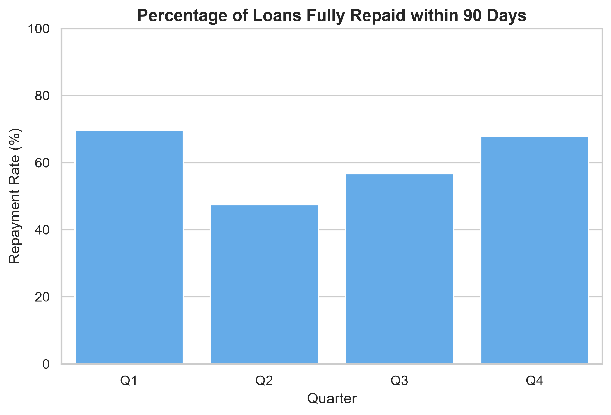
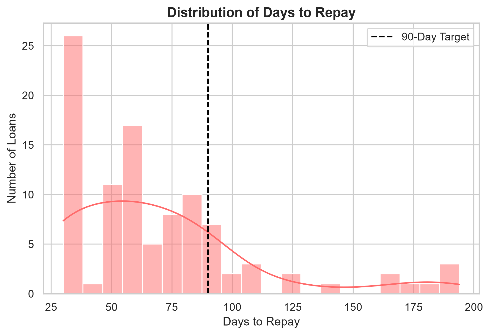
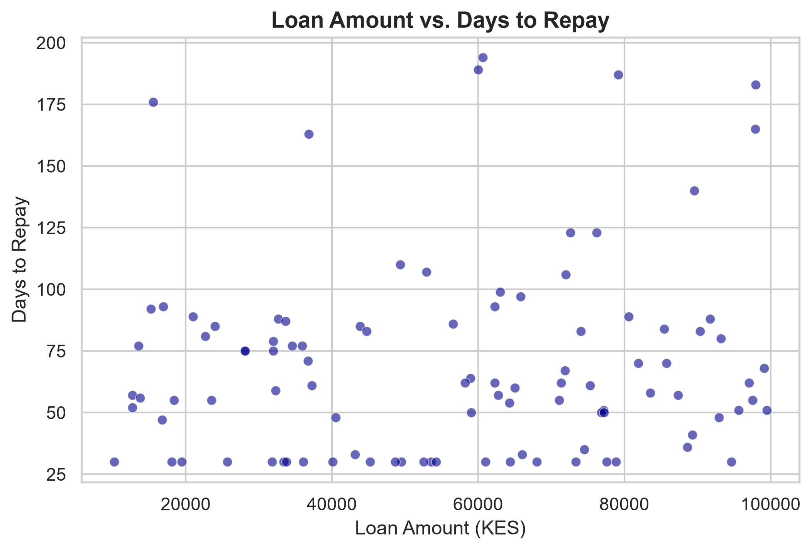

# SACCO Loan Portfolio Analysis

An end-to-end data analysis project evaluating the repayment performance of a SACCO's loan portfolio. This project cleans and merges multiple datasets, calculates time-based metrics, and produces visual reports to answer a critical business question: **What percentage of loans are fully repaid within 90 days?**

## 📈 The Board's Finding
> "Overall, 60.4% of loans across 2025 were fully repaid within the 90-day target, but performance fluctuated significantly, dropping to a concerning low of 47.4% in Q2 before recovering to 67.9% by Q4. The data reveals that Q2's dip was driven by a cluster of slow-paying loans that took over 120 days to clear, rather than a rise in complete defaults. Additionally, the analysis shows no strong correlation between loan size and repayment speed—meaning the Q2 drop was likely operational (e.g., a lag in collections) rather than caused by issuing larger loans. We recommend conducting a targeted review of Q2's loan cohort to identify what broke down in the collections process and ensure that Q4's positive recovery trend continues into the new year."

## 🔍 Key Insights & Visualizations

### 1. Quarterly Repayment Rate
**Question:** What percentage of loans issued in each quarter are fully repaid within 90 days?

### 2. Distribution of Days to Repay
**Question:** How long do loans actually take to pay off, and how many miss the 90-day mark?

### 3. Loan Amount vs. Days to Repay
**Question:** Are larger loans more likely to take longer to repay?

## 🛠️ Data Processing Steps
1. **Merged:** Joined the `loans` and `repayments` tables on `Loan_ID`.
2. **Aggregated:** Grouped multiple payments per loan to find the total amount paid and the final payment date.
3. **Calculated:** Created a `Days_to_Repay` metric by subtracting the issue date from the final payment date.
4. **Flagged:** Applied the 90-day business rule to flag fully repaid loans.
5. **Grouped:** Extracted the financial quarter from the issue date for trend analysis.

## 🚀 How to Run
1. Install requirements:

    `pip install pandas matplotlib seaborn`
2. Generate data: 

    `python generate_sacco_data.py`
3. Process data: 

    `python analyze_sacco.py`
4. Generate report: 

    `python report_sacco.py`